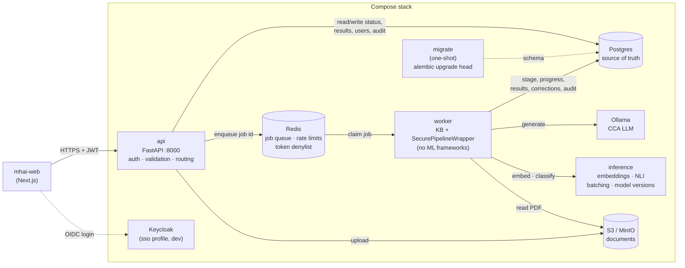
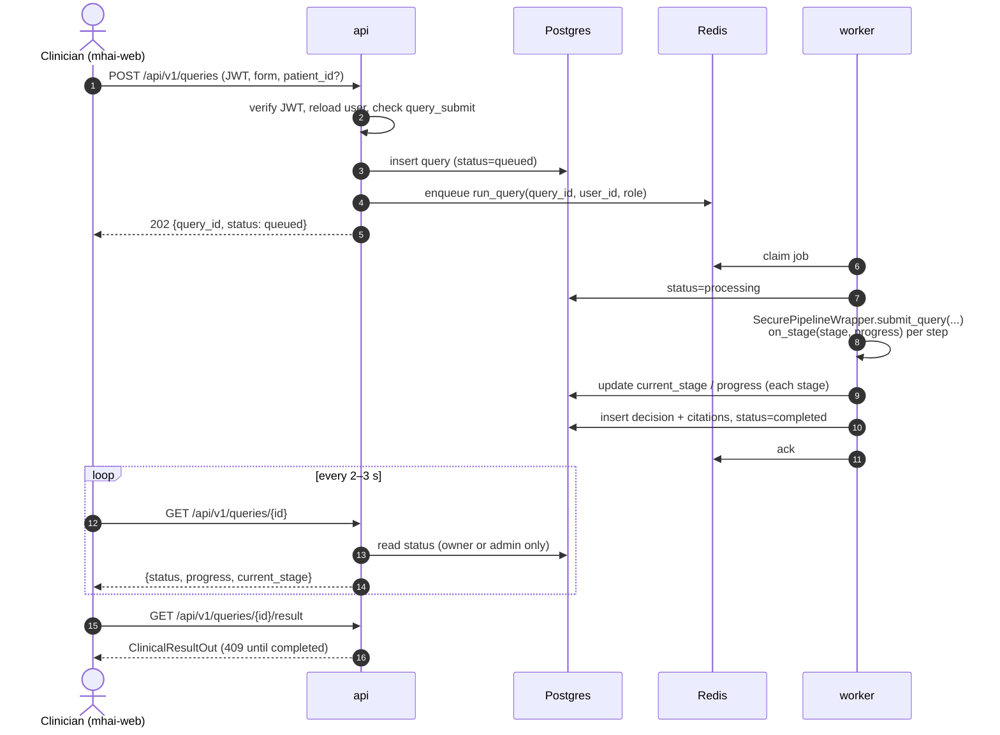
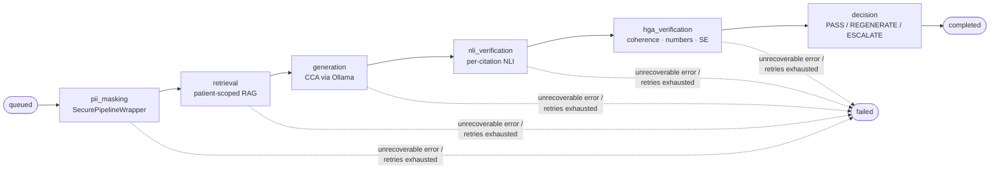
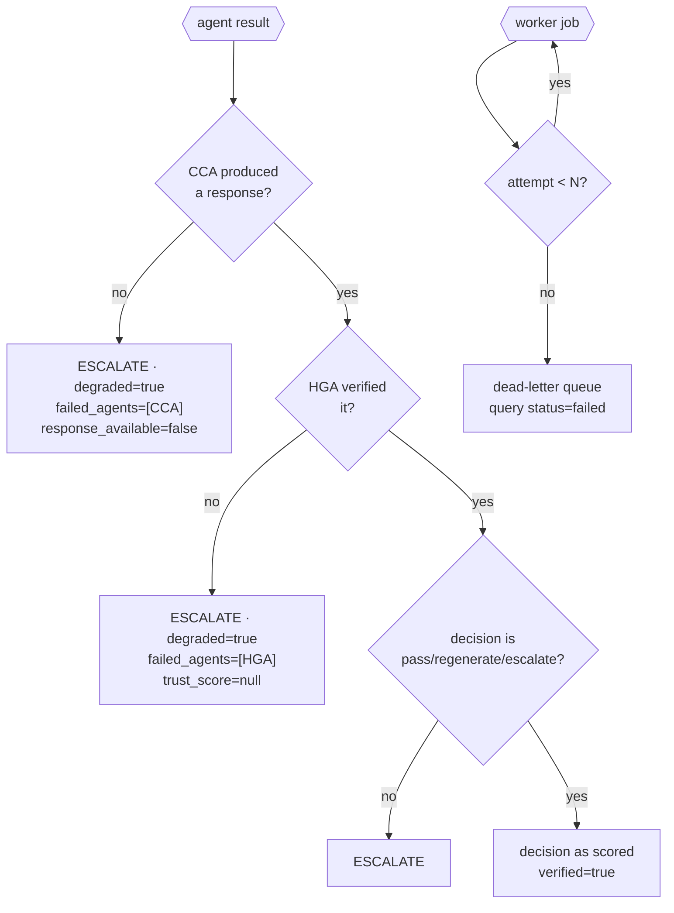
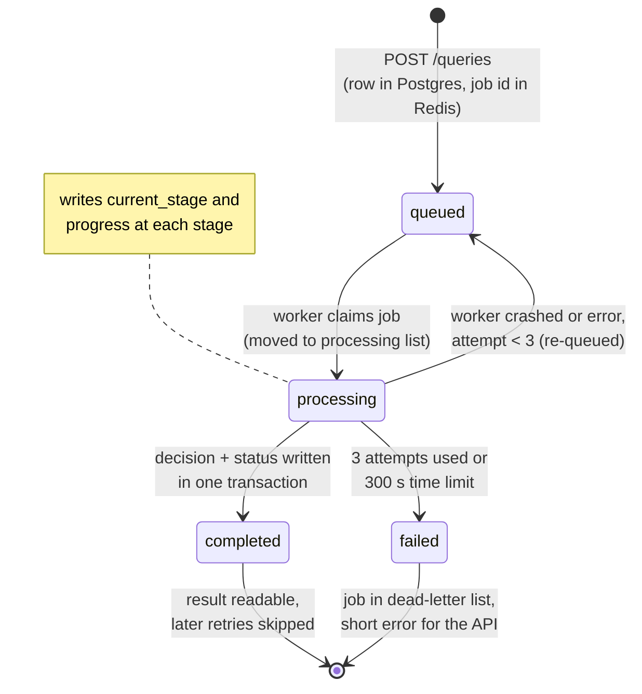
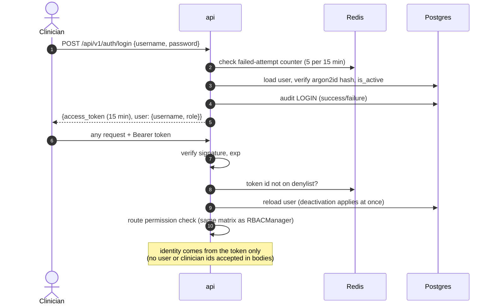
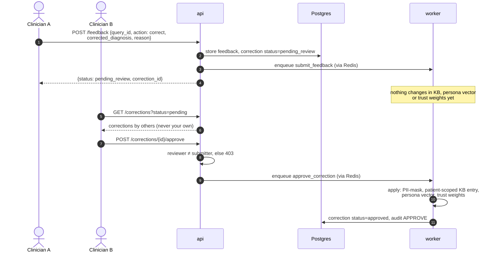
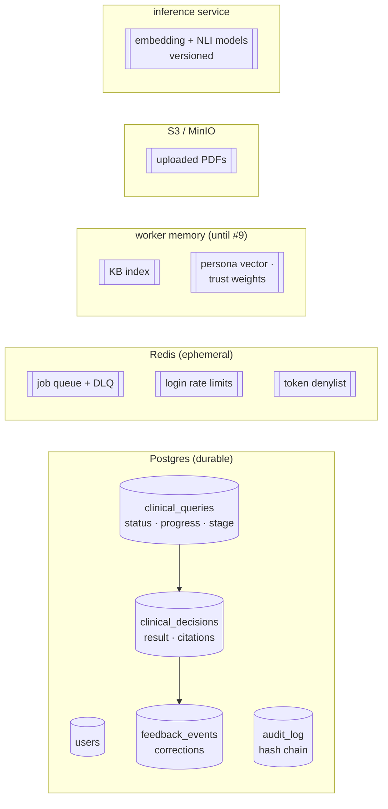
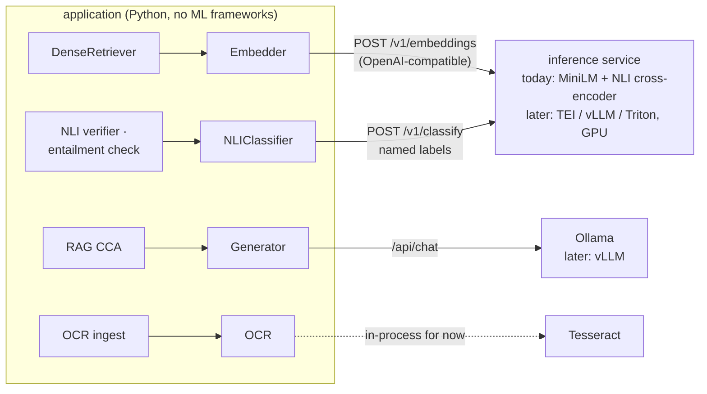
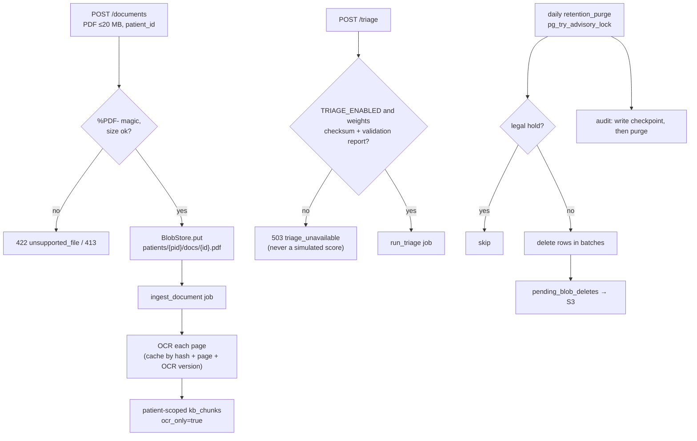

# MHAI Architecture

## System Flow

```
Patient Data → DIA (Swin-V2) → QDA (FT-Transformer) → CCA (Qwen-7B + RAG)
                    ↓                  ↓                       ↓
               G1: SSIM          G2: Confidence          G3: NLI Citation
                    ↓                  ↓                       ↓
                    └──────── HGA (DeBERTa-v3 MoE) ────────────┘
                                       ↓
                              T(y) = α·NLI + β·Coh + γ·Num + δ·SE
                                       ↓
                    ┌──────────────────────────────────────┐
                    │  T ≥ 0.55  →  PASS (auto-approve)   │
                    │  0.30 ≤ T  →  REGENERATE             │
                    │  T < 0.30  →  ESCALATE (human)       │
                    └──────────────────────────────────────┘
                                       ↓
                              Orchestrator Agent
                         (routing + feedback + audit)
```

## 4-Layer Guardrail Cascade

Each response must pass ALL layers to auto-approve. Any single failure triggers review.

## Security Pipeline Order

RBAC → PII Mask → Route → Audit → Encrypt

## Service Architecture (planned, #8)

> **Status: design approved, not yet implemented.** API gateway (#8).
> Full spec: `docs/specs/2026-10-08-api-gateway-phase1-design.md`.
> Decisions: ADR 0007 (API in Python, contract-first) and ADR 0008 (models
> behind inference services).

### 1. Components



The API never loads models or calls the orchestrator. Only the worker calls
`SecurePipelineWrapper`. **Neither imports ML frameworks**: every model is
reached through an inference client (ADR 0008), so engines can change and
inference can scale without touching orchestration. **There is exactly one
worker in Phase 1**, because learning state stays in the worker's memory
until #9.

### 2. Query lifecycle



### 3. Pipeline stages (progress)



Each arrow is an `on_stage(stage, progress)` callback that the worker writes
to Postgres. The frontend's progress stepper reads it.

### 4. Failure handling (fail closed)



### 4b. Job and query states



Redis holds only IDs (`{job_id, type, query_id or correction_id, user_id,
role, attempt}`), never patient data. The worker writes a heartbeat every
10 s, and `/readyz` reports it down after 30 s. Nothing is deleted
automatically in Phase 1; a retention policy is a follow-up decision.

### 5. Login and request authentication



### 6. Feedback and two-person correction approval



### 7. Data ownership



### Deployment changes

| Before | After |
|---|---|
| `mhai` service runs the CLI and exits | `api` serves on :8000 with a real health check, plus a `worker` service |
| schema from `init-db/init.sql` | Alembic migrations, run by a one-shot `migrate` service |
| placeholder `admin` with a fake hash | `mhai users create` (real hashes); `mhai seed-demo` for dev-only synthetic clinicians |

### 8. Inference boundary



Swapping an engine or scaling inference is a configuration change.
Responses carry `model` and `model_version`, which are stored with each
decision.

### 9. Ingest, triage and retention


